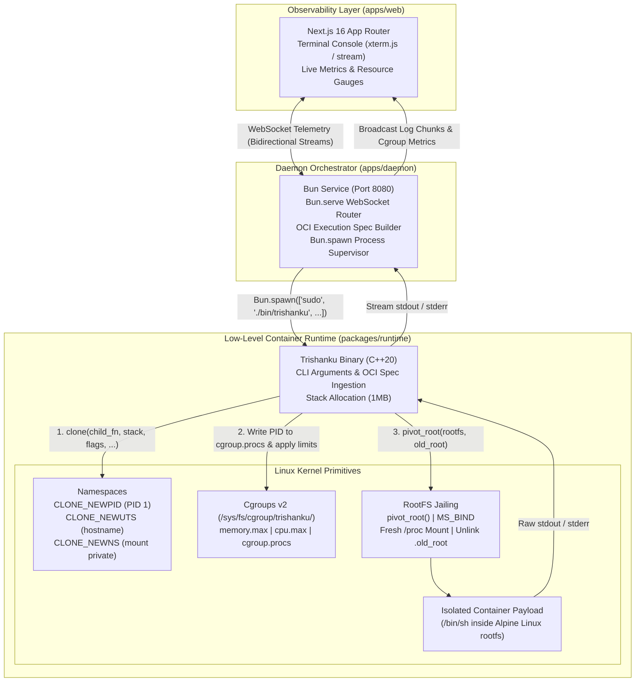

# 🔱 Trishanku — Bare-Metal Linux Container Runtime & Observability Engine

[](https://en.cppreference.com/w/cpp/20)
[](https://man7.org/linux/man-pages/man7/namespaces.7.html)
[](https://bun.sh/)
[](https://nextjs.org/)
[](https://turbo.build/)
[](https://alpinelinux.org/)

**Trishanku** is a bare-metal Linux container runtime engineered from scratch in **C++20**, paired with a **Bun** orchestration daemon and a real-time **Next.js 16** telemetry dashboard within a polyglot Turborepo monorepo.

Standard container platforms (such as Docker, Podman, and containerd) treat the Linux kernel as a black box hidden behind layers of daemon abstraction. Trishanku pulls back the curtain, constructing isolated execution environments using raw Linux kernel primitives: `clone()` syscall flags, process namespaces, unified cgroups v2 hierarchies, and secure filesystem jailing with `pivot_root`.

---

## 📐 1. Architecture & System Flow

Trishanku spans three distinct architectural tiers: the low-level C++ runtime engine, the Bun asynchronous daemon, and the Next.js observability client.



---

## 🧱 2. Core Technical Pillars & Kernel Primitives

### A. Linux Namespaces (Process Isolation)
The Linux kernel uses namespaces to partition global system resources so that processes see only their isolated slice of the system:
* **`CLONE_NEWPID`**: Isolates process IDs. The container's root entry process becomes `PID 1` inside its namespace, taking responsibility for child process harvesting, while carrying an unprivileged host PID.
* **`CLONE_NEWUTS`**: Isolates hostname and NIS domain identities via `sethostname("trishanku-sandbox", ...)`.
* **`CLONE_NEWNS`**: Clones the filesystem mount tree into a private namespace. Mounts are explicitly marked private (`mount(NULL, "/", NULL, MS_REC | MS_PRIVATE, NULL)`) to prevent mount changes from propagating to host namespaces.

### B. Control Groups v2 (Resource Enforcement)
Trishanku enforces strict resource ceilings through the unified cgroups v2 tree (`/sys/fs/cgroup`):
* Dynamically provisions a container leaf cgroup: `/sys/fs/cgroup/trishanku/<container_id>/`.
* Migrates the target PID by writing to `/sys/fs/cgroup/trishanku/<container_id>/cgroup.procs`.
* Enforces hard memory boundaries via `memory.max` (e.g., `268435456` for 256MB) and throttles CPU cycles via `cpu.max` quotas.

### C. Root Filesystem Jailing (`pivot_root`)
Unlike `chroot`—which does not change the root mount and is susceptible to escape via file descriptor hopping or `fchdir()`—Trishanku implements the atomic `pivot_root` sequence:
1. Bind-mounts the extracted Alpine Linux mini-rootfs onto itself (`MS_BIND | MS_REC`).
2. Creates a temporary detachment target directory: `<new_root>/.old_root`.
3. Issues `pivot_root(new_root, old_root)`.
4. Mounts a isolated pseudo-filesystem at `/proc` to guarantee process introspection commands (`ps`, `top`) only reflect the container namespace.
5. Detaches and unmounts the host root via `umount2("/.old_root", MNT_DETACH)` and removes the directory placeholder.

### D. Daemon Orchestrator & Live Telemetry (Bun)
* Serves HTTP and WebSocket endpoints using Bun's native C-level networking.
* Translates API container configurations into execution bundles.
* Invokes the compiled C++ binary using `Bun.spawn()` and captures standard input, output, and error streams as standard `ReadableStream` instances.
* Polls `/sys/fs/cgroup/trishanku/<id>/memory.current` and `cpu.stat` to stream telemetry frames directly to the browser.

---

## 📁 3. Monorepo Organization

```text
trishanku/
├── apps/
│   ├── daemon/                    # Bun + TypeScript process orchestrator & telemetry server
│   │   ├── index.ts               # Bun.serve HTTP/WebSocket router & spawn manager
│   │   ├── package.json
│   │   └── tsconfig.json
│   └── web/                       # Next.js 16 + Tailwind CSS observability dashboard
│       ├── src/
│       │   └── app/               # App Router pages (Terminal, Container Cards, Metrics)
│       ├── package.json
│       └── tsconfig.json
├── packages/
│   ├── runtime/                   # Low-level C++20 container runtime engine
│   │   ├── src/
│   │   │   └── main.cpp           # Kernel clone(), namespaces, cgroups v2, pivot_root
│   │   ├── rootfs/                # Target directory for unpacked Alpine mini-rootfs
│   │   ├── Makefile               # Native g++ build targets (build, run, clean)
│   │   └── package.json           # Turborepo npm bridge ("build": "make build")
│   ├── eslint-config/             # Shared ESLint configuration
│   └── typescript-config/         # Shared TypeScript configuration
├── package.json                   # Root workspace manifest
├── pnpm-workspace.yaml            # Monorepo workspace boundaries
└── turbo.json                     # Turborepo task pipeline orchestration
```

---

## 🗺️ 4. Implementation Roadmap

| Phase | Milestone | Core Components |
|---|---|---|
| **Phase 1** | **Process Namespace Isolation** | `clone()` with `CLONE_NEWPID \| CLONE_NEWUTS \| CLONE_NEWNS`, child stack setup, PID 1 shell verification |
| **Phase 2** | **Filesystem Jailing & RootFS** | Alpine Linux mini-rootfs extraction, `pivot_root` sequence, fresh `/proc` mount, detachment |
| **Phase 3** | **Cgroups v2 Resource Throttling** | Dynamic `/sys/fs/cgroup/trishanku/<id>` leaf nodes, `memory.max`, `cpu.max`, synthetic OOM tests |
| **Phase 4** | **Bun Daemon Orchestration** | `Bun.serve` WebSocket hub, `Bun.spawn()` process manager, stream multiplexing |
| **Phase 5** | **Next.js Observability UI** | Real-time terminal streaming, active container status, live memory & CPU graph cards |

---

## ⚡ 5. Prerequisites & Quickstart

### Prerequisites

* **Linux OS** with Linux Kernel 5.8+ (Cgroups v2 enabled)
* **GCC / G++ 12+** (supporting `-std=c++20`)
* **Make**
* **Bun 1.1+**
* **pnpm 9+** / **Node.js 20+**
* Root privileges (`sudo`) for Linux namespace and cgroup manipulation

### Building the Runtime

```bash
# Clone the repository
git clone https://github.com/avinashk47/trishanku.git
cd trishanku

# Install monorepo dependencies
pnpm install

# Compile the C++20 container runtime via Turborepo
pnpm run build

# Or compile directly in packages/runtime
cd packages/runtime && make build
```

> [!IMPORTANT]
> Linux container primitives (`clone()` with new namespaces, mounting filesystems, and writing to `/sys/fs/cgroup/`) require `root` capabilities or `sudo`.

---

## 🔬 6. Verification & Testing

* **PID Isolation Check**: Running `echo $$` inside the spawned container shell yields `PID 1`.
* **Hostname Isolation Check**: Changing hostname via `hostname trishanku-test` does not alter the host system hostname.
* **Mount Tree Isolation Check**: Host mount table remains untouched when mounts/unmounts occur inside the container.
* **Cgroup Memory Cap Verification**: Stress tests allocating beyond `memory.max` trigger clean kernel OOM termination without impacting host memory stability.
